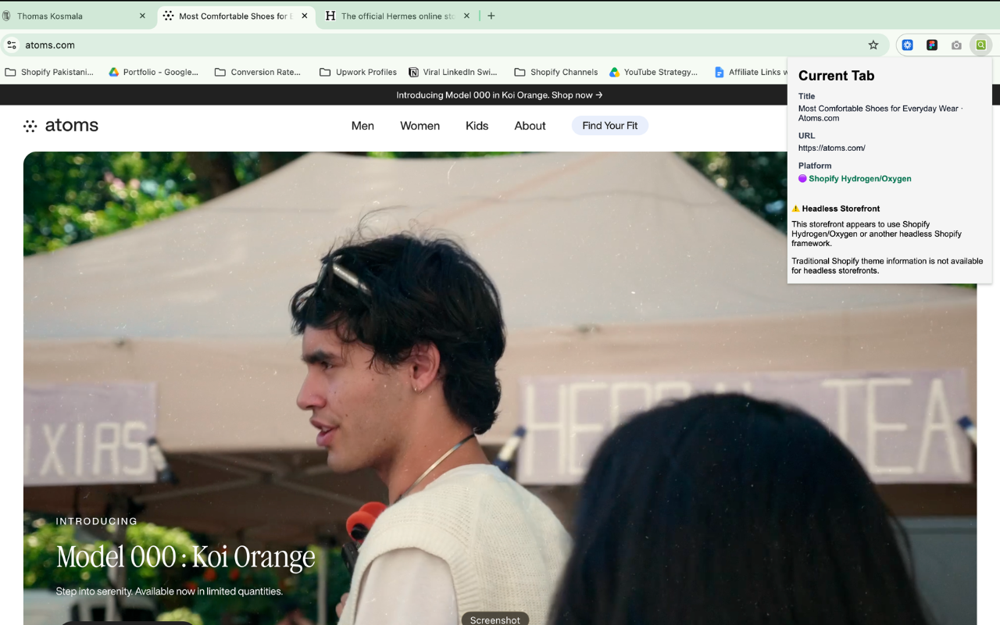

# Shopify Dev Inspector

A free Chrome extension that shows how any Shopify store is built, in one click: its theme, whether it is headless, its language and currency, and which of 50 tested Shopify apps it runs.

**[Install from the Chrome Web Store](https://chromewebstore.google.com/detail/shopify-dev-inspector/ibfcjfhmgbkmlckbbmlfmhcakiikaccf)** · [More about the extension](https://www.ahmadmujtaba.com/tools)

## Features

- Detects Shopify stores, including headless stores built on Hydrogen and Oxygen
- Shows the theme name and theme version, when the store exposes them
- Shows the store language and currency
- Detects 50 tested Shopify apps that load on the storefront, including Klaviyo, Yotpo, Judge.me, Recharge, Rebuy, Gorgias, PageFly and Weglot (full list in `app-fingerprints.js`)
- Works with a single click, with nothing to set up

## Screenshots

| Shopify store | Headless store | Not Shopify |
| --- | --- | --- |
|  |  |  |

## Privacy

The extension reads only the page you open it on. All detection runs locally in your browser. It collects no personal data or browsing history and sends nothing to any server. See [docs/privacy-policy.md](docs/privacy-policy.md).

## Limits

- Some stores hide their theme name or version; the extension shows "Not Exposed" for those.
- App detection covers the 50 tested apps and only finds apps that load something on the page you are viewing. Apps that work only in the Shopify admin will not appear.

## Development

1. Clone this repository.
2. Open `chrome://extensions`.
3. Turn on **Developer mode**.
4. Click **Load unpacked** and select the project folder.

To add an app, add its fingerprint to `app-fingerprints.js`.

## Changelog

See [CHANGELOG.md](CHANGELOG.md).

## Author

Built by [Ahmad Mujtaba](https://www.ahmadmujtaba.com), Shopify Select Partner.

## License

MIT License
